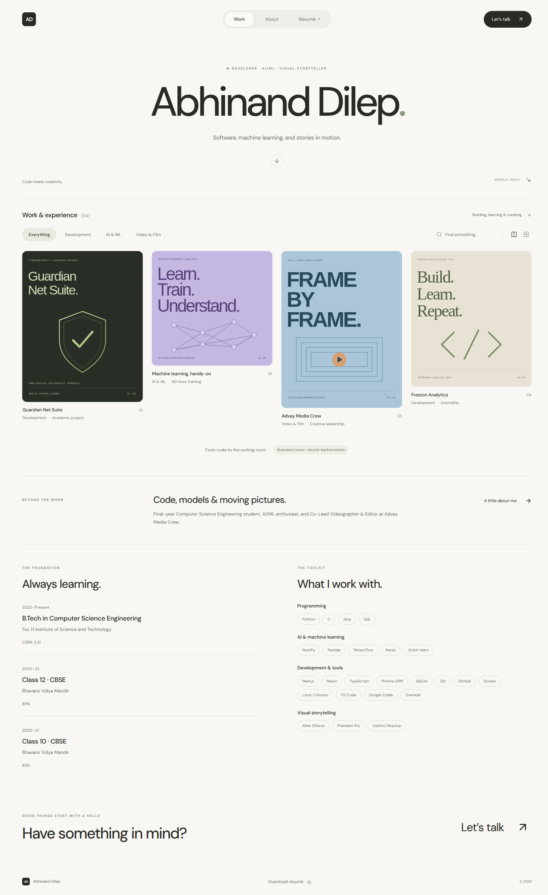
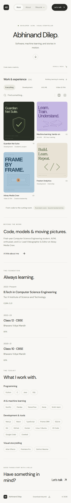

# Abhinand Dilep — Portfolio

A quiet, image-led personal portfolio inspired by the gallery layouts, understated typography, and rounded controls of [Cosmos](https://www.cosmos.so). Built with React, TypeScript, and Vite. No backend or account required.

Personal details, skills, education, qualifications, and experience are populated from the supplied résumé. The gallery contains one academic project (Guardian Net Suite), an internship at Freston Analytics, ML training at Aesthetix Edutech, and creative leadership at Advay Media Crew. The original covers are illustrative, not project screenshots.

**Live site:** https://dist-jeshlhev.devinapps.com



## Run locally

Requires Node.js 22.18+ (Node.js 24 recommended).

```sh
npm ci
npm run dev
```

Open the URL printed by Vite. To create a production build:

```sh
npm run build
npm run preview
```

The `dist/` folder can be served by any static hosting provider. The live site above is a published production build; pushing changes to GitHub does not automatically redeploy it.

## Make it yours

All personal content lives in **`src/portfolio.ts`**:

1. Update `profile`: name, initials, tagline, role, location, introduction, availability, email, phone, résumé path, languages, and social URLs.
2. Update `projects`: titles, category, entry label, description, highlights, role, optional period, tools, and project URL. The collection deliberately distinguishes projects from training and experience.
3. Put your images in `public/images/` and update each project's `image`, `alt`, and `aspectRatio`. Images are referenced from the public root, for example `/images/my-project.jpg`.
4. Update `skills`, `education`, `credentials`, `coursework`, and `activities`. Replace `public/Abhinand-Dilep-Resume.pdf` when your résumé changes.
5. Update the page title, description, and favicon in `index.html` and `public/favicon.svg` as needed.

Contact information and social links come from the supplied PDF, including its embedded link targets. Add an HTTP(S) project URL to enable a “Visit project” link; no project repositories or demo URLs were supplied, so no links were invented.

Once you have real project screenshots or video stills, replace the illustrated covers and update the image descriptions and illustration labels in `src/App.tsx`.

Colors, spacing, typography, and responsive layouts are in `src/styles.css`. The font and illustrations are bundled locally, so visitors do not need an external font or image service.

## Included

- Responsive masonry-style gallery with comfortable and compact layouts
- Category filtering and case-insensitive search, including clear/reset states
- Project detail dialogs with optional project links
- About, Résumé, and Contact dialogs
- Education and categorized skills sections
- Downloadable original résumé, email/copy controls, phone, LinkedIn, and GitHub links
- Native dialog focus handling, Escape/backdrop dismissal, focus outlines, and reduced-motion support
- Self-hosted variable DM Sans font

## Code checks

```sh
npm run lint
npm run typecheck
npm test
npm run build
```

The eight unit tests cover gallery filtering, combined search/category behavior, empty results, unique project IDs, image paths, safe external URL handling, verified contact links, and resume-backed entries. They are not browser end-to-end tests.

## Asset credits

- All SVG covers are original illustrations made for this portfolio; no images, logos, or code were taken from Cosmos.
- The downloadable PDF is the résumé provided for this update and contains the contact information displayed on the site.
- DM Sans is licensed under the SIL Open Font License; see `public/fonts/OFL.txt`.

## Mobile preview


